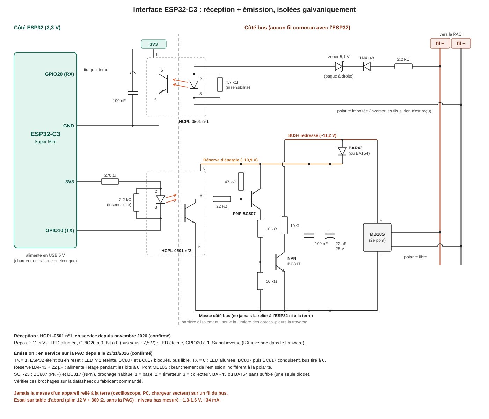

[English](hardware.md) · **Français**

# Matériel : une interface ESP32 isolée pour le bus CIAT

Un **ESP32-C3** écoute le bus à travers un optocoupleur et répond à la PAC à travers un second. **Aucun fil n'est
commun entre l'ESP32 et le bus** : seule la lumière des optocoupleurs traverse la barrière d'isolement.

> ⚠️ **À lire d'abord.**
> - Le retour du bus est **relié à la terre dans la PAC**. Ne reliez jamais la masse d'un appareil relié à la
>   terre (oscilloscope, PC en USB, chargeur avec terre) à un fil du bus : sur l'installation de référence, cela a
>   arrêté la communication et mis la PAC en défaut (voir [protocole §1](protocol.fr.md#1-couche-physique)).
> - Le côté ESP32 doit rester isolé. Alimentez-le par n'importe quel chargeur USB ou batterie ; ne reliez jamais
>   sa masse au bus.
> - **N'alimentez jamais l'ESP32 par le bus.** Le bus est une ligne de signal qui alimente aussi un tout petit
>   terminal : le terminal d'origine consomme **~1,5 mA en moyenne** (ondulation de 1 à 5 mA, mesurée avec un shunt
>   de 22 Ω dans un fil du bus), alors qu'un ESP32-C3 demande ~80 mA avec des pointes à 300 mA quand le Wi-Fi émet.
>   Les prendre sur le bus le ferait chuter et perturberait la communication, ou surchargerait l'alimentation du
>   terminal dans la PAC.
> - **Essayez d'abord l'étage d'émission sur table**, sur une alimentation 12 V avec une résistance série de
>   ~300 Ω, avant de le brancher sur la PAC.
> - Quand l'ESP32 émet, **le terminal d'origine doit être débranché** : deux terminaux qui répondent en même
>   temps entrent en collision. Le firmware détecte un autre terminal et arrête d'émettre.

## 1. Réception (RX) ✅

| Composant | Valeur | Rôle |
|---|---|---|
| HCPL-0501 n°1 | optocoupleur rapide, SO-8 | isolement |
| résistance | 2,2 kΩ | courant de la LED |
| diode | 1N4148 | bloque la polarité inversée |
| zener | 5,1 V (en inverse) | relève le seuil |
| résistance | 4,7 kΩ en parallèle sur la LED | désensibilisation (fuites) |
| condensateur | 100 nF entre les broches 8 et 5 | découplage de l'optocoupleur |

- Branché entre les deux fils du bus. **La polarité compte** pour cet étage : si rien n'est reçu, inversez les
  fils.
- Au repos (~11,5 V), la LED est allumée et GPIO20 est à 0. Pendant un bit à 0, de la PAC (~0 V) ou d'un
  terminal (~1,5-3 V entre les fils), la LED s'éteint et GPIO20 passe à 1. Le signal est **inversé** ; le
  firmware inverse l'entrée de l'UART.
- 🟡 Calculé, non mesuré : seuil ≈ 7,5 V (zener 5,1 V + 1N4148 0,6 V + LED ~1,3 V + chute dans 2,2 kΩ) ; courant
  ≈ 2 mA à 11,5 V. Le terminal lui-même consomme ~1,5 mA ; le bus n'est pas perturbé.
- ✅ Les deux sens sont reçus : ~265 trames de la PAC et ~265 trames du terminal par minute, 0 octet rejeté.

Montages qui **n'ont pas fonctionné** (pour mémoire) : un pont diviseur sur le BUS+ redressé ne voit que les
trames du terminal ; le même pont entre les deux fils ne voit que celles de la PAC (le niveau bas du terminal
reste à ~2-3 V entre les fils). Il faut un seuil vers 6-8 V entre les fils, ce que donne la zener.

## 2. Émission (TX) ✅

| Composant | Valeur | Rôle |
|---|---|---|
| HCPL-0501 n°2 | SO-8 | isolement |
| résistance | 270 Ω, 3V3 → anode de la LED | courant de la LED (cathode sur GPIO10) |
| résistance | 2,2 kΩ en parallèle sur la LED | désensibilisation |
| PNP | BC807 (SOT-23) | translation de niveau |
| résistances | 22 kΩ (base), 47 kΩ (base-émetteur) | commande du PNP |
| NPN | BC817 (SOT-23) | tire le bus vers 0 |
| résistances | 10 kΩ (collecteur du PNP → base), 10 kΩ (base-émetteur) | commande du NPN |
| résistance | 10 Ω dans le collecteur du NPN | limitation du courant |
| pont | MB10S (2ᵉ pont) | l'émission fonctionne dans les deux polarités |
| diode | BAR43 (ou BAT54 sans suffixe) | charge la réserve depuis BUS+ |
| condensateurs | 22 µF 25 V + 100 nF | réserve : alimente l'étage pendant les bits à 0 |

- TX = 1 (UART au repos), ESP32 éteint ou en reset : LED éteinte, transistors bloqués, **bus libre**. Un ESP32
  planté ou qui redémarre ne tient jamais le bus. TX = 0 : LED allumée, le BC807 puis le BC817 conduisent, le
  bus est tiré vers 0.
- **GPIO10** pour TX. Éviter GPIO21 (journal de la ROM au démarrage) et les broches de configuration GPIO2, 8
  et 9.
- **Résultats du banc** (alimentation 12 V + 300 Ω) ✅ :
  - repos 10,96 V : l'étage d'émission ne charge pas la ligne de façon visible ;
  - **niveau bas ~1,3-1,6 V**, **~34 mA** (les deux diodes du MB10S comptent pour ~1,3 V) ; le terminal
    d'origine descend à ~0,5 V et la PAC accepte les deux ;
  - 7 500 trames renvoyées en écho, couvrant les 256 valeurs d'octet : **0 écho faux** ;
  - 🟡 les bits à 0 sortent ~23 µs plus longs que la normale (104 µs par bit), sans doute le temps de blocage
    des transistors. Une UART lit au milieu du bit : c'est sans effet, et la PAC accepte toutes les trames
    depuis le 23/11/2026.
- Sur la PAC ✅ : ~530 réponses par minute, la PAC répond à chacune, pas d'écho faux en fonctionnement normal (un
  écho raté isolé toutes les quelques heures ; le firmware reprend seul).

## 3. Carte ESP32

- **ESP32-C3 « Super Mini »** (`esp32-c3-devkitm-1` dans ESPHome). RX sur **GPIO20**, TX sur **GPIO10**.
- Le firmware écrit son journal sur l'USB natif : l'UART matérielle reste libre pour le bus.
- Wi-Fi : l'antenne du Super Mini est mal adaptée ; réduire la puissance d'émission à **8,5 dB** a rendu la
  connexion fiable sur l'installation de référence.
- Alimentation : USB 5 V par n'importe quel chargeur ou batterie. **Le bus ne peut pas alimenter l'ESP32**
  (~80 mA avec des pointes à 300 mA, contre ~1,5 mA pour le terminal).

## 4. Branchement

1. Montez la carte et essayez-la sur table.
2. Coupez l'alimentation de la PAC avant de toucher au bus.
3. Branchez les deux fils du bus (connecteur J2, bornes 1-2 de la carte de la PAC, ou bornes du terminal).
4. Pour **écouter seulement**, gardez le terminal d'origine branché et compilez le firmware avec l'émission
   désactivée.
5. Pour **remplacer le terminal**, débranchez-le. Après un redémarrage, l'émulateur écoute 20 s avant d'émettre,
   ne démarre pas si un autre terminal répond, et s'arrête en moins d'une seconde s'il en apparaît un ensuite.

## 5. L'intérieur du terminal d'origine (pour mémoire)

Photos avec repères numérotés dans [`hardware/terminal/`](../hardware/terminal/) : `1-power-input` (repères 1-8),
`2-receive-backlight` (9-18), `3-microcontroller` (19-20), `4-back`, `5-supercapacitor` et `6-ntc-pins` (21-31).
Les identifications ont été vérifiées sur les marquages ; les **liaisons** entre composants ont été lues sur les photos, pas mesurées (🟡).

| N° | Composant | Marquage | Rôle |
|---|---|---|---|
| 1 | pont de diodes MB10S | `B10S` | entrée : le bus est insensible à la polarité ✅ |
| 2 | diode SOD-123 n°1 | `S7` | sépare BUS+ de la réserve d'alimentation ✅ |
| 3 | résistance 100 kΩ | `1003` | 🟡 R1, de BUS+ vers la base du PNP de réception |
| 4 | régulateur SOT-23 | `F933` | alimentation (🟡 ~3 V) |
| 5 | diode SOD-123 n°2 | `S7` | rail du régulateur → VCC du microcontrôleur |
| 6 | résistance 47 Ω | `470` | en série avec le supercondensateur ✅ |
| 7 | transistor SOT-23 T1 | `W03` (?) | **émission** : collecteur ouvert sur BUS+, tire le bus à ~0,5 V ✅ |
| 8 | 2 pastilles vissées | — | arrivée du bus |
| 9 | MIC4827 (MSOP-8) | `4827` | pilote du rétroéclairage électroluminescent ✅ |
| 10 | PNP BC857B | `K3W` (?) | translateur de niveau de **réception** |
| 11 | NPN BC847B | `K1F` (?) | **réception** : collecteur → 1 kΩ → RX du microcontrôleur |
| 12 | SOT-23 | `L83` (?) | ❓ rôle inconnu |
| 13 | diode MELF rouge | — | diode du MIC4827 (sortie CS) ✅ |
| 14 | résistance 1 MΩ | `1004` | REL du MIC4827 (fréquence de la lampe) ✅ |
| 15 | résistance 340 kΩ | `3403` | RSW du MIC4827 (fréquence de découpage) ✅ |
| 16 | résistance 49,9 kΩ | `4992` | ❓ rôle inconnu |
| 17 | résistance 1 kΩ | `102` | collecteur du NPN [11] → RX du microcontrôleur ✅ |
| 18 | 4 résistances 100 kΩ | `1003` | réseau de réception (PNP + NPN), 🟡 câblage exact |
| 19 | QFP, NEC µPD78F9418A (🟡) | `F9418AGC` | microcontrôleur avec pilote LCD |
| 20 | SO-8 | `24WG02W` (?) | EEPROM (🟡 24C02, programmes hebdomadaires) |
| 21, 28, 29 | cylindres au verso | — | condensateurs électrolytiques |
| 22 | connecteur blanc + nappe verte | — | lampe électroluminescente du rétroéclairage ✅ |
| 23 | composant bleu carré | — | self L1 du MIC4827 ✅ |
| 24 | composant bleu ovale (3 pattes) | — | ❓ inconnu |
| 25 | quartz cylindrique | — | 🟡 32,768 kHz (horloge) |
| 26 | potentiomètre | `PIHER` | la molette, lue en 8 positions ✅ |
| 27 | cylindre bas à languette | `GC 5.5V` | supercondensateur 5,5 V, sauvegarde de l'horloge ✅ |
| 30 | perle orange au verso | — | sonde d'ambiance CTN ✅ |
| 31 | 2 picots | — | arrivée du bus |
