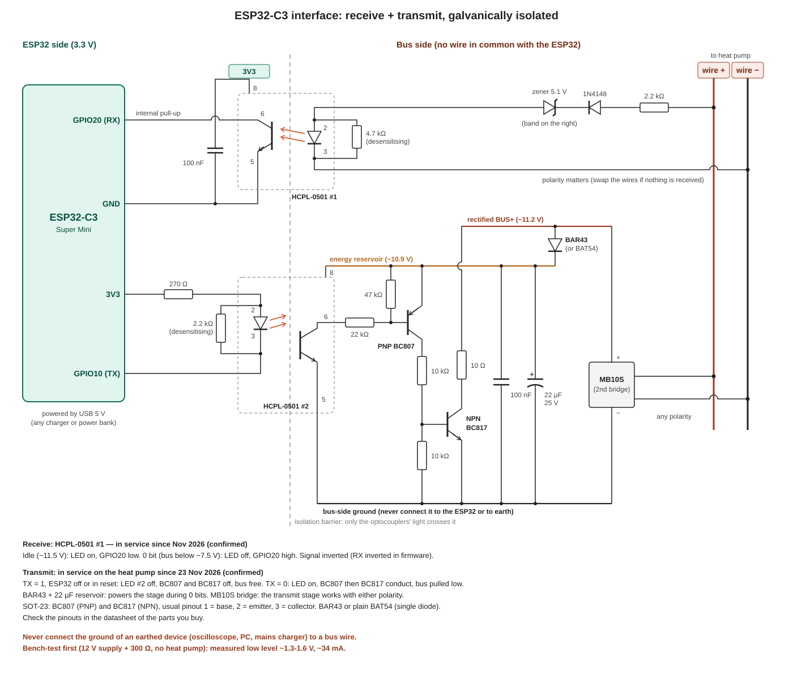

**English** · [Français](hardware.fr.md)

# Hardware: an isolated ESP32 interface for the CIAT bus

An **ESP32-C3** listens to the bus through one optocoupler and answers the heat pump through a second one.
**No wire is shared between the ESP32 and the bus**: only the optocouplers' light crosses the isolation barrier.

> ⚠️ **Read this first.**
> - The bus return is **tied to earth inside the heat pump**. Never connect the ground of an earthed device
>   (oscilloscope, PC on USB, mains-earthed charger) to a bus wire: it stopped the communication and put the
>   heat pump into fault on the reference installation (see [protocol §1](protocol.md#1-physical-layer)).
> - The ESP32 side must stay isolated. Power it from any USB charger or power bank; never tie its ground to the
>   bus.
> - **Never power the ESP32 from the bus.** The bus is a signal line that also feeds a very small terminal: the
>   original terminal draws **~1.5 mA on average** (1 to 5 mA ripple, measured with a 22 Ω shunt in a bus wire), while
>   an ESP32-C3 needs ~80 mA with 300 mA peaks when Wi-Fi transmits. Drawing that from the bus would pull it down
>   and corrupt the communication, or overload the heat pump's terminal supply.
> - **Bench-test the transmit stage first**, on a 12 V supply with a ~300 Ω series resistor, before connecting
>   it to the heat pump.
> - When the ESP32 transmits, **the original terminal must be unplugged**: two terminals answering at once
>   collide. The firmware detects another terminal and stops transmitting.

## 1. Receive (RX) ✅

| Part | Value | Role |
|---|---|---|
| HCPL-0501 #1 | high-speed optocoupler, SO-8 | isolation |
| resistor | 2.2 kΩ | LED current |
| diode | 1N4148 | blocks reverse polarity |
| zener | 5.1 V (in reverse) | raises the threshold |
| resistor | 4.7 kΩ across the LED | desensitising (leakage) |
| capacitor | 100 nF between pins 8 and 5 | optocoupler supply decoupling |

- Wired across the two bus wires. **Polarity matters** for this stage: if nothing is received, swap the wires.
- At idle (~11.5 V) the LED is on and GPIO20 is low. During a 0 bit, from the heat pump (~0 V) or from a
  terminal (~1.5-3 V between the wires), the LED goes off and GPIO20 goes high. The signal is **inverted**;
  the firmware inverts the UART input.
- 🟡 Calculated, not measured: threshold ≈ 7.5 V (zener 5.1 V + 1N4148 0.6 V + LED ~1.3 V + drop in 2.2 kΩ);
  current ≈ 2 mA at 11.5 V. The terminal itself draws ~1.5 mA; the bus is not disturbed.
- ✅ Both directions are received: ~265 heat-pump frames and ~265 terminal frames per minute, 0 rejected byte.

Approaches that **did not work** (for reference): a resistor divider on the rectified BUS+ only sees the terminal's
frames; the same divider between the two wires only sees the heat pump's frames (the terminal's low level stays
at ~2-3 V between the wires). A threshold around 6-8 V between the wires is needed, which the zener provides.

## 2. Transmit (TX) ✅

| Part | Value | Role |
|---|---|---|
| HCPL-0501 #2 | SO-8 | isolation |
| resistor | 270 Ω, 3V3 → LED anode | LED current (LED cathode on GPIO10) |
| resistor | 2.2 kΩ across the LED | desensitising |
| PNP | BC807 (SOT-23) | level shift |
| resistors | 22 kΩ (base), 47 kΩ (base-emitter) | PNP drive |
| NPN | BC817 (SOT-23) | pulls the bus low |
| resistors | 10 kΩ (collector of PNP → base), 10 kΩ (base-emitter) | NPN drive |
| resistor | 10 Ω in the NPN collector | current limit |
| bridge | MB10S (2nd bridge) | the transmit stage works with either polarity |
| diode | BAR43 (or plain BAT54) | charges the reservoir from BUS+ |
| capacitors | 22 µF 25 V + 100 nF | reservoir: powers the stage during 0 bits |

- TX = 1 (UART idle), ESP32 off or in reset: LED off, both transistors off, **bus free**. A dead or rebooting
  ESP32 never holds the bus. TX = 0: LED on, BC807 then BC817 conduct, the bus is pulled low.
- **GPIO10** for TX. Avoid GPIO21 (boot log of the ROM) and the strapping pins GPIO2, 8 and 9.
- **Bench results** (12 V supply + 300 Ω) ✅:
  - idle 10.96 V: the transmit stage does not load the line visibly;
  - **low level ~1.3-1.6 V**, **~34 mA** (the two diodes of the MB10S account for ~1.3 V); the original terminal
    reaches ~0.5 V and the heat pump accepts both;
  - 7,500 echoed frames covering all 256 byte values: **0 wrong echo**;
  - 🟡 0 bits come out ~23 µs longer than nominal (104 µs per bit), probably the transistors' turn-off time. A UART
    samples in the middle of the bit, so it does not matter: the heat pump has accepted every frame since 23 Nov
    2026.
- On the heat pump ✅: ~530 answers per minute, the heat pump answers every one of them, no wrong echo in normal
  operation. An isolated missed echo every few hours: the heat pump still answers it, so the firmware tolerates it.

## 3. ESP32 board

- **ESP32-C3 "Super Mini"** (`esp32-c3-devkitm-1` in ESPHome). RX on **GPIO20**, TX on **GPIO10**.
- The firmware logs on the native USB, so the hardware UART is free for the bus.
- Wi-Fi: the Super Mini's antenna is poorly matched; reducing the transmit power to **8.5 dB** made the connection
  reliable on the reference installation.
- Power: USB 5 V from any charger or power bank. **The bus cannot power the ESP32** (~80 mA with 300 mA peaks,
  against ~1.5 mA for the terminal).

## 4. Connection

1. Build and bench-test the board.
2. Power off the heat pump before touching the bus.
3. Connect the two bus wires (connector J2, terminals 1-2 of the heat-pump board, or the terminal's own terminals).
4. To **listen only**, keep the original terminal connected and build the firmware with transmission disabled.
5. To **replace the terminal**, unplug it. After a reboot the emulator listens for 20 s before transmitting, does
   not start if another terminal answers, and stops within a second if one appears later.

## 5. Inside the original terminal (for reference)

Photos with numbered markers in [`hardware/terminal/`](../hardware/terminal/): `1-power-input` (markers 1-8),
`2-receive-backlight` (9-18), `3-microcontroller` (19-20), `4-back`, `5-supercapacitor` and `6-ntc-pins` (21-31).
Identifications were checked against the markings; the **connections** between parts were read from the photos, not measured (🟡).

| # | Part | Marking | Role |
|---|---|---|---|
| 1 | bridge rectifier MB10S | `B10S` | input: the bus is polarity-independent ✅ |
| 2 | SOD-123 diode #1 | `S7` | separates BUS+ from the supply reservoir ✅ |
| 3 | resistor 100 kΩ | `1003` | 🟡 R1, from BUS+ to the receive PNP base |
| 4 | SOT-23 regulator | `F933` | supply (🟡 ~3 V) |
| 5 | SOD-123 diode #2 | `S7` | regulator rail → microcontroller VCC |
| 6 | resistor 47 Ω | `470` | in series with the supercapacitor ✅ |
| 7 | SOT-23 transistor T1 | `W03` (?) | **transmit**: open collector on BUS+, pulls the bus to ~0.5 V ✅ |
| 8 | 2 screw pads | — | bus input |
| 9 | MIC4827 (MSOP-8) | `4827` | electroluminescent backlight driver ✅ |
| 10 | PNP BC857B | `K3W` (?) | **receive** level shifter |
| 11 | NPN BC847B | `K1F` (?) | **receive**: collector → 1 kΩ → microcontroller RX |
| 12 | SOT-23 | `L83` (?) | ❓ unknown role |
| 13 | red MELF diode | — | MIC4827 diode (CS output) ✅ |
| 14 | resistor 1 MΩ | `1004` | MIC4827 REL (lamp frequency) ✅ |
| 15 | resistor 340 kΩ | `3403` | MIC4827 RSW (switching frequency) ✅ |
| 16 | resistor 49.9 kΩ | `4992` | ❓ unknown role |
| 17 | resistor 1 kΩ | `102` | NPN [11] collector → microcontroller RX ✅ |
| 18 | 4 resistors 100 kΩ | `1003` | receive network (PNP + NPN), 🟡 exact wiring |
| 19 | QFP, NEC µPD78F9418A (🟡) | `F9418AGC` | microcontroller with LCD driver |
| 20 | SO-8 | `24WG02W` (?) | EEPROM (🟡 24C02, weekly programmes) |
| 21, 28, 29 | cylinders on the back | — | electrolytic capacitors |
| 22 | white connector + green ribbon | — | electroluminescent backlight lamp ✅ |
| 23 | blue square part | — | MIC4827 inductor L1 ✅ |
| 24 | blue oval part (3 pins) | — | ❓ unknown |
| 25 | cylindrical crystal | — | 🟡 32.768 kHz (clock) |
| 26 | potentiometer | `PIHER` | the dial, read as 8 positions ✅ |
| 27 | low cylinder with a tab | `GC 5.5V` | 5.5 V supercapacitor, clock backup ✅ |
| 30 | orange bead on the back | — | NTC room sensor ✅ |
| 31 | 2 pins | — | bus input |
